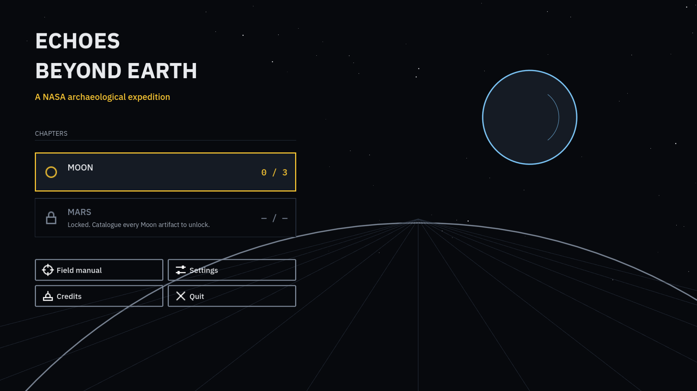
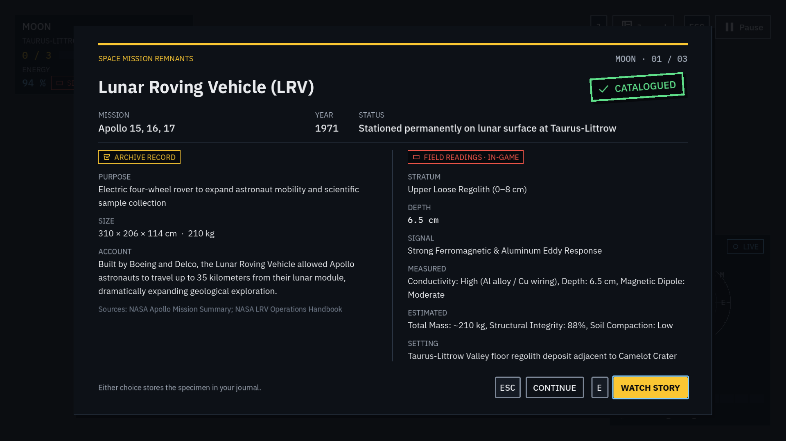

# Echoes Beyond Earth

### *A NASA archaeological expedition — Abandoned, but not forgotten.*




**Echoes Beyond Earth** is a 3D educational exploration game. You play a small astronaut-archaeologist who walks across the Moon and Mars, **digs up the hardware NASA left behind**, cleans it, and files it in an archive. Every find unlocks its real mission history, its science, and a short illustrated story.

It is our entry for the NASA challenge **"Abandoned but not Forgotten: Storytelling about NASA's Discarded Equipment on the Moon and Mars."**

---

## Contents

1. [The challenge](#the-challenge)
2. [Our idea](#our-idea)
3. [How it plays](#how-it-plays)
4. [The hardware you will meet](#the-hardware-you-will-meet)
5. [Controls](#controls)
6. [Getting started](#getting-started)
7. [Project structure](#project-structure)
8. [How it works](#how-it-works)
9. [Adding a new artifact](#adding-a-new-artifact)
10. [Testing](#testing)
11. [Design system](#design-system)
12. [Status and known limitations](#status-and-known-limitations)
13. [Sources and credits](#sources-and-credits)

---

## The challenge

> Since the 1960s, NASA has left hardware across the solar system: on the Moon, on Mars, and in deep space. From rovers and instruments that completed their science missions to probes still traveling away from Earth, this hardware varies widely in both its purpose and current level of functionality. Your challenge is to **tell the story of some or all of this equipment** in a way that **introduces school-age space enthusiasts to the hardware and the science it made possible.**

## Our idea

A textbook tells students that the Lunar Roving Vehicle is still on the Moon. A game can make them *find it*.

We framed the abandoned hardware as an **archaeological dig on other worlds**. The things NASA left behind are the artifacts, and the player is the field archaeologist. That frame does three things for a young audience:

- **Curiosity first, facts second.** The scanner tells you *that* something is buried and *how close* you are, never *what* it is. The reveal happens when you clean the object, so the history lands as a reward.
- **Real hardware, real status.** Every artifact answers three questions: what was it for, what did it achieve, and what state is it in now? Some completed their missions, some were silenced by dust or cold, and one flew 72 times and then stopped.
- **Story in layers.** A quick catalogue card, a deeper "Archive record" with measurements and sources, and an optional illustrated **Watch Story** flashback for the human drama.

## How it plays

Each find goes through the same loop:

1. **Scan.** A proximity scanner and a radar dial show signal strength and distance. They never show what the object is. Follow the signal.
2. **Excavate.** When you are standing over an anomaly, start the dig mini-game. Clear layers of regolith, avoid rocks, and chain combos to expose the artifact.
3. **Clean.** Brush away the dust until the specimen is clear. It emerges from the dirt as you scrub.
4. **Catalogue.** A declassified-archive entry opens with the mission, year, purpose, current status, size, mass and a "field readings" panel with the stratum, depth, signal type and measured properties.
5. **Watch the story (optional).** A three-scene illustrated flashback tells the human story behind the machine.
6. **Unlock the next world.** Recover all three Moon artifacts to unlock **Mars**, which has 13 sites.



*A catalogued Lunar Roving Vehicle. The "Archive record" side holds the verified history and its sources. The "Field readings" side holds the in-game dig data.*

## The hardware you will meet

The game currently contains **16 artifacts**: 3 on the Moon and 13 on Mars. All data lives in [`data/artifacts.json`](data/artifacts.json).

### Moon (3)

| Artifact | Mission | Year | Status |
|---|---|---|---|
| Lunar Roving Vehicle (LRV) | Apollo 15, 16, 17 | 1971 | Stationed permanently at Taurus-Littrow |
| Apollo Lunar Module Descent Stage | Apollo 11 | 1969 | Historic monument at Tranquility Base |
| Apollo Lunar Surface Experiments Package (ALSEP) | Apollo 12–17 | 1969 | Deactivated in 1977 after eight years of seismic and thermal science |

### Mars (13)

| Artifact | Mission | Year | Status |
|---|---|---|---|
| Viking 1 Lander | Viking Project | 1976 | Stationary, intact historical lander on Chryse Planitia |
| Viking 2 Lander | Viking Project | 1976 | Stationary lander in the Utopia Planitia rock field |
| Mars Pathfinder Lander | Mars Pathfinder | 1997 | Stationary monument at Ares Vallis |
| Sojourner Rover | Mars Pathfinder | 1997 | Mission completed; preserved at Ares Vallis |
| Opportunity Rover (MER-B) | Mars Exploration Rover | 2004 | Completed its mission in 2018 after 14.5 years |
| Spirit Rover (MER-A) | Mars Exploration Rover | 2004 | Inactive, embedded in sulfate sand at Troy |
| Phoenix Mars Lander | Mars Scout Program | 2008 | Stationary arctic lander in winter CO₂ ice remnants |
| InSight Mars Lander | Discovery Program | 2018 | Inactive, SEIS dome on Elysium soil |
| Ingenuity Mars Helicopter | Mars 2020 | 2021 | Grounded after rotor damage; completed 72 flights |
| Perseverance Jettisoned Thermal Protection Tile | Mars 2020 | 2021 | Impact scatter remnant on the Jezero plains |
| Jezero Delta Smectite Clay Mudstone | Mars 2020 reference | 2022 | Sedimentary rock core target in the delta front |
| Séítah Formation Olivine Cumulate | Mars 2020 reference | 2021 | In-situ fractured igneous bedrock |
| Impact-Preserved Martian Shergottite | Geological survey | 2022 | Weathered basaltic rock clast with desert varnish |

Three artifacts also have hand-written flashback stories in [`data/flashbacks.json`](data/flashbacks.json): the LRV, the Apollo 11 descent stage and ALSEP. The rock and tile entries are science-context "reference" finds that teach geology alongside the machines.

## Controls

| Action | Key |
|---|---|
| Move | `W` `A` `S` `D` or arrow keys |
| Jump | `Space` |
| Walk / lope (low-gravity bounding) | `C` to toggle, or hold `Shift` |
| Interact / dig / recover | `E` |
| Examine a geology sample | `F` |
| Toggle camera view | `V` |
| Zoom camera | Mouse wheel |
| Open the journal | `J` |
| Pause / close dialogs | `Esc` |
| Brush while cleaning | Hold the left mouse button |

An in-game **Field manual** (main menu) walks through scan, dig, catalogue and controls. Settings include fullscreen and reduced motion.

## Getting started

### Requirements

- [**Godot 4.7**](https://godotengine.org/download) (the project declares `4.7`). Automated tests have been run headless on Godot 4.4.1 and 4.7.
- A GPU that supports OpenGL. The project uses the **GL Compatibility** renderer, so it runs on modest hardware.
- Keyboard and mouse. Some menu screens also respond to a gamepad.

### Run it

```bash
git clone https://github.com/alsabithka/nasa_project.git
cd nasa_project
```

1. Open Godot and choose **Import**, then select `project.godot`.
2. Let Godot import the assets on first open. This can take a minute.
3. Press **F5** (Play). The main scene is `scenes/main_menu.tscn`.

Or from the command line:

```bash
godot --path .
```

### Good to know

- Start on the **Moon** chapter. **Mars is locked** until all three Moon artifacts are catalogued, and the menu shows why.
- "Restart mission" in the pause menu keeps catalogued specimens, because progress lives in an autoload singleton for the session.

## Project structure

```text
nasa_project/
├── project.godot               # Godot 4.7, GL Compatibility, lunar gravity (1.62 m/s²)
├── AGENTS.md                   # Contribution rules for AI-assisted development
├── CREDITS.md                  # Data, font, icon and audio credits
├── data/                       # All educational content, kept as JSON
│   ├── artifacts.json          #   16 artifact records
│   ├── flashbacks.json         #   illustrated story scenes
│   └── artifact_videos.json    #   documentary-video manifest (template)
├── scenes/
│   ├── main_menu.tscn          # Entry point
│   ├── levels/                 # moon.tscn, mars.tscn
│   ├── artifact/               # The diggable artifact (Area3D)
│   ├── player/                 # Astronaut character
│   ├── scanner/                # Proximity scanner
│   ├── spacecraft/             # Spacecraft gallery (not wired into the menu yet)
│   └── ui/                     # HUD, dig/clean, flashback, pause, settings, components
├── scripts/
│   ├── autoload/game_state.gd  # GameState singleton: progress, unlocks, resources
│   ├── levels/                 # Moon and Mars terrain generation
│   ├── player/                 # Movement, camera, metal detector, audio
│   ├── scanner/                # Signal strength and distance
│   ├── artifact/               # Dig → clean → catalogue pipeline
│   ├── spacecraft/             # Procedural models of historical spacecraft
│   ├── environment/            # Dust, footprints, glints, Mars atmosphere
│   ├── ui/                     # HUD, panels, mini-games, tokens, settings store
│   │   └── components/         #   reusable widgets (ArchiveCard, RadarDial, KeyCap…)
│   ├── qa/                     # Screenshot capture and the test runner
│   └── test_*.gd               # Headless test suites
├── shaders/                    # Mars regolith surface shader
├── textures/ · audio/          # Lunar textures and ambient music
├── assets/                     # Fonts (IBM Plex), 23 SVG icons, video placeholder
├── design-system/              # "Declassified Archive" design system
├── references/                 # NASA technical reference sheet for the spacecraft
└── documentation/              # Interfaces, phase logs, plans, screenshots
```

## How it works

### Data-driven content

Educational text never lives in code. Each artifact is a JSON record, so teachers or content writers can add or correct entries without touching GDScript.

```json
{
  "id": "ingenuity",
  "name": "Ingenuity Mars Helicopter",
  "location": "Mars",
  "mission": "Mars 2020",
  "year": 2021,
  "purpose": "Technology demonstration of powered flight",
  "status": "Grounded after rotor damage",
  "history": "Verified historical narrative goes here",
  "sources": ["NASA official mission page"]
}
```

Records also carry optional richer fields used by the catalogue and journal: `category`, `stratigraphic_layer`, `discovery_depth_cm`, `dimensions_cm`, `mass_kg`, `detection_signature`, `geological_context`, `measured_properties` and `estimated_properties`. UI code treats all of them as optional.

### Key systems

| System | File | What it does |
|---|---|---|
| **GameState** (autoload) | `scripts/autoload/game_state.gd` | Loads `artifacts.json`, tracks recovered artifacts, unlocks Mars when the Moon is complete, tracks energy and minerals |
| **Scanner** | `scripts/scanner/scanner.gd` | Emits `scan_updated(target_id, distance, signal_strength)`. Never reveals identity |
| **Scanner instrument + radar** | `scripts/ui/components/` | Signal states (none / faint / moderate / strong / dig) plus a radar dial |
| **Artifact** | `scripts/artifact/artifact.gd` | Runs the dig → clean → catalogue → story pipeline for one find |
| **Terrain** | `scripts/levels/moon_terrain.gd`, `mars_terrain.gd` | Procedural spherical worlds. Mars also spawns six historical spacecraft at their landing latitudes and longitudes |
| **Spacecraft models** | `scripts/spacecraft/historical_spacecraft_models.gd` | Procedurally built models of the landers and rovers |
| **Flashback** | `scripts/ui/flashback_system.gd` | Plays the story scenes from `flashbacks.json` |
| **UITokens / SettingsStore** | `scripts/ui/` | Design tokens and persisted user settings (static classes, not autoloads) |

Scanner ranges: strong signal within **15 m**, moderate within **35 m**, faint out to **65 m**, and digging is possible within **4 m**.

The public contracts between systems (signals, method names, data format) are documented in [`documentation/INTERFACES.md`](documentation/INTERFACES.md). Please follow them when adding features.

## Adding a new artifact

1. **Add a record** to `data/artifacts.json` with a unique, stable `id`, a `location` of `"Moon"` or `"Mars"`, and a source list.
2. **Place it.** Add an `Artifact` instance with the same `artifact_id` to the level scene, or add it to the historical spacecraft catalogue in `mars_terrain.gd` so it spawns at real coordinates.
3. **(Optional) Add a story.** Add three scenes under the same id in `data/flashbacks.json`.
4. **(Optional) Add a documentary video.** Follow [`documentation/ARTIFACT_VIDEO_WORKFLOW.md`](documentation/ARTIFACT_VIDEO_WORKFLOW.md) and the storyboard template.
5. **Validate** the data with `scripts/qa/check_artifacts_data.gd`.

`GameState.get_total_count()` reads the JSON, so the planet progress counters and the unlock rule update automatically.

## Testing

Tests are headless GDScript suites in `scripts/test_*.gd`. To run them all and compare with the recorded baseline:

```bash
scripts/qa/run_all_tests.sh /path/to/godot
```

Run a single suite:

```bash
godot --headless --path . --script res://scripts/test_phase7_discovery_loop.gd
```

At the last recorded run (see the merge log), **17 suites passed**, covering the menu, pause and settings, dig and clean, the discovery loop (including Moon complete → Mars unlocked), flashbacks, the radar, character animation and terrain. Four older suites are recorded as known failures that predate the UI merge: `interaction_stability`, `mars_photorealistic_simulator`, `photorealistic_moon_simulator` and `polish_and_fixes`. Details are in [`documentation/MERGE_LOG.md`](documentation/MERGE_LOG.md).

Screenshots at 1280×720, 1366×768 and 1920×1080 for each UI phase are in [`documentation/screenshots/`](documentation/screenshots/).

## Design system

The interface follows a **"Declassified Archive"** direction: an instrument panel from a 1970s deep-space programme crossed with modern mission-control software.

- Swiss grid, hard edges and no drop shadows
- A dark ink and paper palette, with colour reserved for signals such as discoveries and warnings
- IBM Plex Mono for telemetry and IBM Plex Sans for prose
- 23 original SVG icons, with scanner states told apart by shape so they do not rely on colour alone
- Reduced-motion setting and keyboard and gamepad focus

See [`design-system/echoes-beyond-earth/MASTER.md`](design-system/echoes-beyond-earth/MASTER.md), the [design tokens](design-system/echoes-beyond-earth/design-tokens.json) and the [UI/UX plan](documentation/UI_UX_REDESIGN_PLAN.md).

## Status and known limitations

This is a working prototype. The honest state of things:

- **Playable:** menu, Moon and Mars levels, scanner and radar, dig and clean mini-games, catalogue entries, journal, flashbacks, pause and settings.
- **Flashback stories** are written for 3 of 16 artifacts. The others show the catalogue entry only.
- **Documentary videos** are a data-driven template with one placeholder clip (the LRV). They are off by default.
- **Deep-space probes** (Pioneer 10 and 11, Dawn, Kepler, NEAR Shoemaker) have reserved asset folders and are not playable yet.
- **Spacecraft gallery** scene exists but is not wired into the main menu.
- **Geology panel (`F`)** still uses the older glass-panel look.
- **Specimen images** use a vector placeholder. A real NASA photo can be dropped in through `SpecimenReveal.backdrop`.
- **Progress is not saved** between sessions.
- **Audio:** one ambient music track. UI sounds are not added yet.
- **Hand-testing:** the project notes recommend a quick manual pass of `E` on the Moon, pause and the radar on a real GPU with Godot 4.7.
- The rock and tile entries (clay, olivine, shergottite, heat shield) are reference or analogue finds, as their records state.

### Roadmap

- Flashbacks for all 16 artifacts, and real NASA imagery with credits
- A deep-space chapter: Pioneer 10 and 11, Dawn, Kepler and NEAR Shoemaker
- Save and load, and a teacher-facing mission checklist for classrooms
- UI sound design and audio credits
- Web export for classroom use without installation

## Sources and credits

Historical and geological information comes from NASA and partner archives:

- NASA Lunar Sample Compendium (Meyer, C., NASA JSC)
- Apollo Lunar Surface Journal (Jones, E. M., NASA HQ)
- Lunar Reconnaissance Orbiter Camera, LROC (ASU / NASA GSFC)
- Smithsonian 3D Heritage and NASA 3D Resources: Apollo LRV, Lunar Module descent stage, ALSEP
- NASA mission pages (Pathfinder, Mars Exploration Rovers, Mars 2020 and others), linked per spacecraft in [`references/historical_spacecraft_reference_sheet.md`](references/historical_spacecraft_reference_sheet.md)

Other credits:

- **Fonts:** IBM Plex Sans and IBM Plex Mono, © IBM Corp., under the [SIL Open Font License 1.1](assets/fonts/OFL.txt)
- **Icons:** original artwork made for this project
- Full details in [`CREDITS.md`](CREDITS.md)

> This is an independent educational project made for the challenge. It is not an official NASA product, and NASA does not endorse it.

## Team

<!-- Add your team name and members here. -->

## License

<!-- No LICENSE file is in the repository yet. Add one and name it here. Fonts keep their own SIL OFL license. -->
